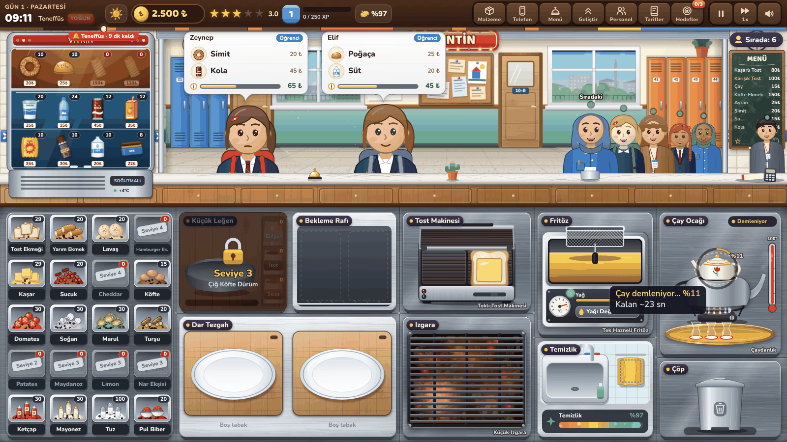
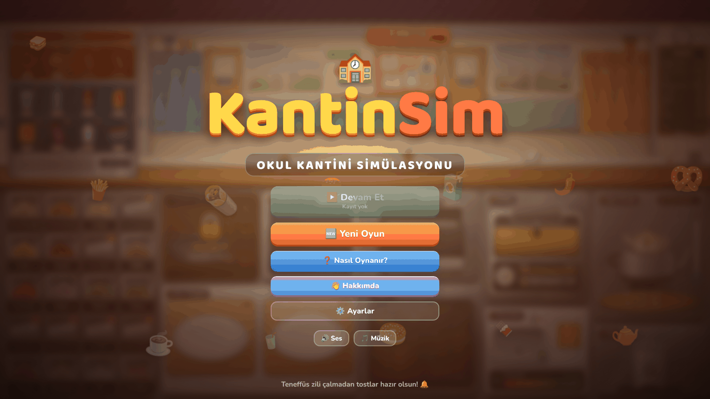
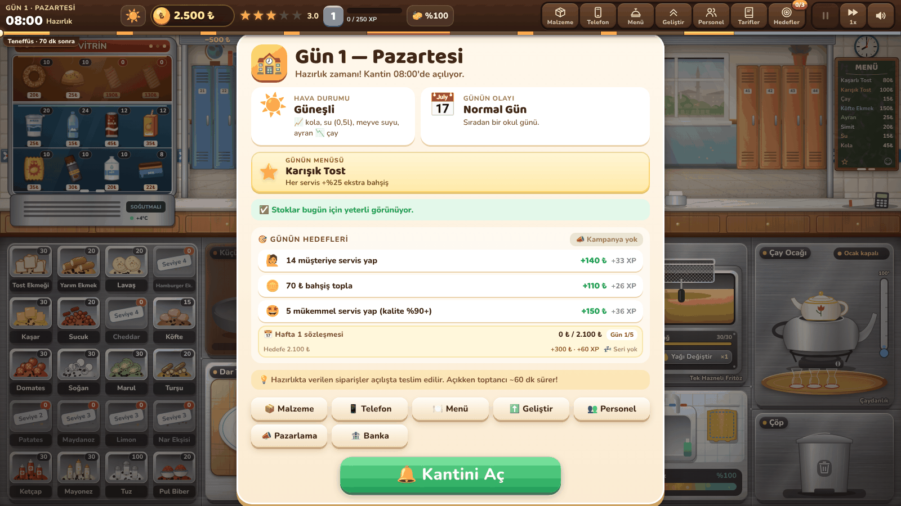
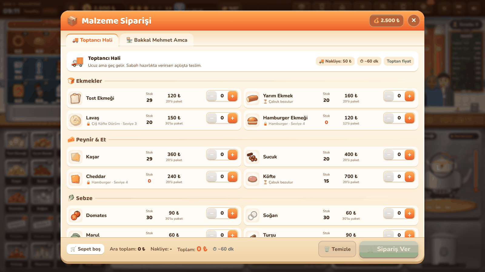
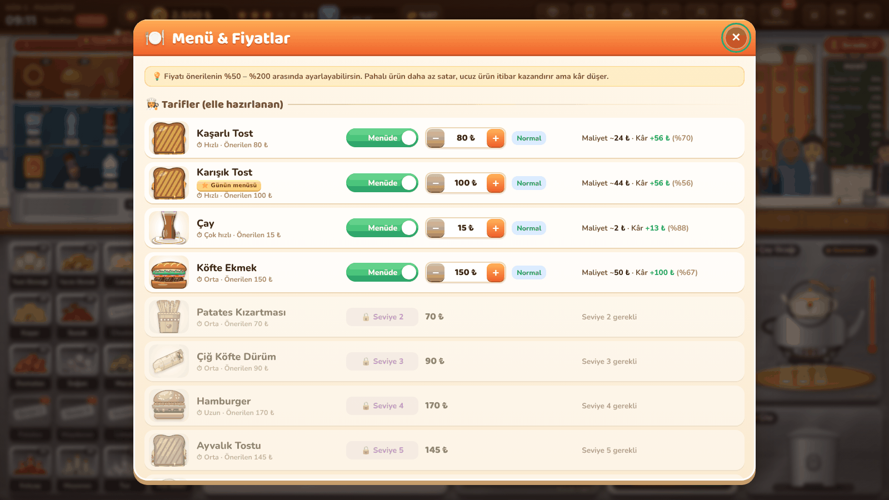
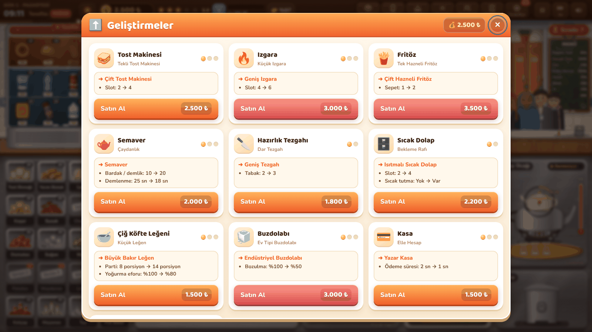
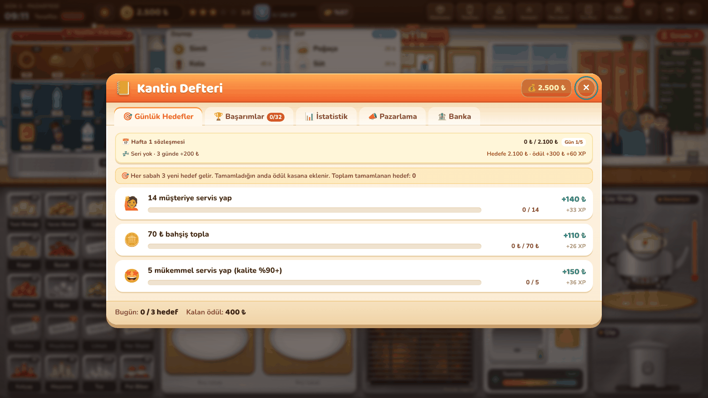
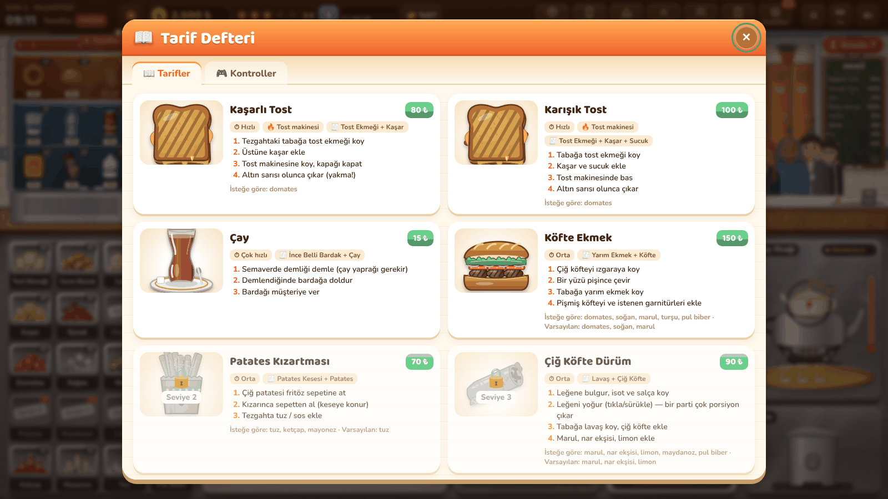

# 🥪 KantinSim — Okul Kantini Simülasyonu

Okul kantininin içindesin. Servis penceresine gelen öğrencilere, öğretmenlere, hizmetlilere ve müdüre
malzemelerden kendi elinle yemek hazırla, dışarıdan hazır döner / çiğ köfte / lahmacun sipariş edip vitrinde sat,
stok, fiyat, temizlik ve itibar yöneterek kantinini büyüt.



## Ekran görüntüleri

| | |
|---|---|
|  **Ana menü** |  **Günlük hazırlık**: hava, olay, günün menüsü, hedefler |
|  **Malzeme siparişi** |  **Menü & fiyatlar** |
|  **Geliştirmeler** |  **Kantin Defteri** |
|  **Tarifler** | |

## Nasıl oynanır?

**Tarayıcıda oyna:** https://kimliksizpro.github.io/KantinSim/

Kurulum yok. `index.html` dosyasını bir tarayıcıda aç (veya klasörde `python3 -m http.server` çalıştırıp
`http://localhost:8000` adresine git). Fare ve dokunmatik ekranla oynanır.

- **Sürükle-bırak**: malzemeyi kutudan tabağa, tabağı tost makinesine, yemeği müşteriye sürükle.
- **Kısa dokun** = eşyayı ele al, tekrar dokun = bırak. **Sağ tık / Esc** = eldekini geri koy.
- Köfteye **tıkla** = çevir · tost makinesinin **kapağına tıkla** · semaverde **demliğe tıkla** · fritöz **sepetine tıkla**.
- Elinde **bez** varken kirlerin üzerinden geç = temizle.
- **Boşluk / P / Esc** = duraklat. **1 / 2** = oyun hızı. **F** = tam ekran.
- **Panel kısayolları**: M Malzeme · T Telefon · N Menü · G Geliştir · E Personel · R Tarifler · K Hedefler.
- **Tarif yardımcısı** (H ile aç/kapat): elin boşken müşterinin üzerine gel, siparişi için gereken kutular ve istasyonlar altın renkle yanar.
- **Sıra**: ilk gün 2 gişe, ikinci gün 3, sonra 4 gişe açık. Fazla gelenler koridorda sıraya girer; başlarındaki nokta sabırlarını gösterir. Sıradaki müşterinin sabrı yavaş azalır, gişeye gelince baştan başlar.
- **Gün şeridi**: üst çubuğun altındaki şerit zil programıdır; turuncu bölümler teneffüs ve öğle arası, etiket sıradaki yoğunluğa kalan süreyi gösterir.
- **Günün menüsü**: her gün bir yemek öne çıkar (hazırlık kartında ve Menü panelinde ⭐ ile işaretli). O yemeği servis eden her müşteri, fiyatının %25'i kadar ekstra bahşiş bırakır (en az 3 ₺); gün sonu raporunda kaç servis yaptığın yazar.
- **Haftalık sözleşme**: her 5 okul günü bir haftadır. Hazırlık kartında haftanın ciro hedefi ve ödülü görünür; hedefi tutarsan hafta içinde bir kez para + XP alırsın, son güne kadar tutmazsa sözleşme yanar.
- **Kârlı gün serisi**: net kârı pozitif biten her gün seriyi büyütür (🔥). 3, 5, 10 ve 20 günlük eşiklerde bir kez para + XP ödülü verilir; zararlı gün seriyi sıfırlar, rekor kalır.
- **Ayarlar → Işık & derinlik efektleri**: gölge/ışık/parallax katmanı. Yavaş cihazda kapatabilirsin (FPS uzun süre düşük kalırsa oyun kendisi de kapatır).
- **Telefon/tablet**: oyun yatay modda oynanır; dikey tutulduğunda ekranı çevirme uyarısı çıkar. Üst çubuk, paneller, hazırlık kartı, gün sonu ve ana menü sahneyle birlikte küçülmez: düğmeler 44×44 dokunma hedefine çıkar, etiketler ikona döner, dar ekranda listeler tek sütuna iner.
- **Çevrimdışı / kurulabilir**: siteyi bir kez açtıktan sonra internet olmadan da oynanır. Chrome/Edge'de adres çubuğundaki "Yükle" ile uygulama gibi kurulabilir (PWA).

## Tarifler (elle yapılan)

| Yemek | Nasıl |
|---|---|
| Kaşarlı Tost | Tost ekmeği + kaşar → tost makinesi |
| Karışık Tost | Tost ekmeği + kaşar + sucuk → tost makinesi |
| Köfte Ekmek | Izgarada iki yüzü pişmiş köfte + yarım ekmek + domates/soğan/marul |
| Hamburger | Köfte + cheddar + hamburger ekmeği + garnitür & sos |
| Çiğ Köfte Dürüm | Leğende bulgur + isot + salça yoğur → lavaş + çiğ köfte + marul + nar ekşisi + limon |
| Patates Kızartması | Fritözde kızart → keseye → tuz / ketçap / mayonez |
| Çay | Semaverde demle → ince belli bardağa doldur |
| Kaşarlı Sandviç *(Sv. 2)* | Yarım ekmek + kaşar + domates/marul (+ turşu, ketçap, mayonez) |
| Sucuklu Sandviç *(Sv. 3)* | Yarım ekmek + sucuk + domates/turşu/mayonez (+ kaşar, marul) |
| Lavaş Pizza *(Sv. 4)* | Lavaş + kaşar + sucuk + domates + ketçap → tost makinesi |
| Ayvalık Tostu *(Sv. 5)* | Tost ekmeği + kaşar + sucuk + domates + turşu + ketçap/mayonez → tost makinesi |
| Köfte Dürüm *(Sv. 6)* | Izgarada pişmiş köfte + lavaş + domates/soğan/maydanoz |

Müşteriler özel istekte bulunabilir: **"soğansız"**, **"+turşu"**, **"+pul biber"**… Balona dikkat!

## Hazır ürünler

- **Toptancı / Bakkal**: ayran, su, süt, kola, meyve suyu, cips, çikolata, gofret, kek, soğuk çay, fırın sütlaç, ev limonatası ve tüm malzemeler (toptancı ucuz ama geç; bakkal pahalı ama hızlı).
- **Telefonla sipariş (kurye)**: Dönerci (et/tavuk döner dürüm), Çiğköfteci (hazır dürüm), Fırın (simit, poğaça, su böreği), Pideci (lahmacun, kıymalı pide).
  Hazır yemekler gün sonunda bozulur — doğru miktarda sipariş ver!

## Simülasyon mekanikleri

- **Okul zil programı**: ders saatinde sakin, teneffüste ve öğle arasında akın. Zil çalınca öğrenciler derse yetişmek için sabırsızlanır.
- **Pişme dereceleri**: çiğ → tam kıvamında → fazla → yanık. Tost, köfte (iki yüz), patates, çay demi.
- **Kalite & bahşiş**: doğru, sıcak ve hızlı servis = bahşiş ve itibar. Yanlış garnitür, yanık yemek = şikâyet.
- **Ekonomi**: kira, elektrik/su/tüp faturası, personel yevmiyesi, malzeme bozulması (buzdolabı geliştirmesi azaltır), iflas sınırı.
- **Fiyatlandırma**: menü fiyatlarını kendin belirle — pahalıysa talep düşer.
- **Geliştirmeler**: tost makinesi, ızgara, fritöz, semaver, tezgah, sıcak dolap, çiğ köfte leğeni, buzdolabı, kasa, dekorasyon.
- **Personel**: çaycı çırak, temizlikçi, kasiyer.
- **Hava durumu & günlük olaylar**: yağmurda çay, sıcakta ayran; sağlık müfettişi denetimi, elektrik kesintisi, maç günü, veli toplantısı, sınav haftası, harçlık günü, sağlıklı beslenme haftası, bilim şenliği, karne günü.
- **Temizlik**: tezgah kirlenir, müşteriler ve müfettiş fark eder.
- **Seviye & kilitler**: XP ile yeni tarifler, restoranlar ve personel açılır. Oyun otomatik kaydedilir.

## Kantin Defteri (📒 HUD'daki 🎯 Hedef düğmesi)

- **Günlük hedefler**: her sabah 3 rastgele hedef (ör. "70 müşteriye servis yap", "5 adet Köfte Ekmek sat",
  "günü hiç kızgın müşteri olmadan bitir"). Tamamlanınca anında para + XP ödülü.
- **Haftalık sözleşme**: 5 günlük ciro hedefi; hazırlık kartında ve defterde ilerlemesi, kalan tutar ve ödülü yazar.
- **Kârlı gün serisi**: üst üste kârlı günler, rekor ve sıradaki seri ödülü aynı satırda takip edilir.
- **Başarımlar**: 32 başarım (ilk müşteri, kusursuz gün, müdürün takdiri, temizlik belgesi, tam menü…), her biri XP / para ödüllü.
- **İstatistik**: günlük net kâr, müşteri, ciro ve itibar grafikleri; rekorlar; tüm zamanların en çok satanları.
- **Pazarlama**: hazırlıkta günlük kampanya — okul panosuna afiş, okul radyosu, sosyal medya, bedava çay ikramı, sadakat kartı.
- **Banka**: esnaf / işletme / yatırım kredisi. Taksitler gün sonunda ödenir, erken kapamada faiz indirimi.
- **Toplu sipariş**: ders saatlerinde öğretmenler odası, rehberlik servisi veya spor salonu arar; görevli gelince
  3 kalemlik siparişi eksiksiz ver — bahşiş ×1,8 ve ek XP.
- **Usta Aşçı Nihat** *(Sv. 6 personel)*: ızgaradaki köfteyi zamanında çevirir, fritöz sepetini yanmadan kaldırır.
- Yeni günlük olaylar: **Okul Gezisi**, **Öğretmenler Günü**, **Hayır Kermesi**, **Sağlıklı Beslenme Haftası**, **Bilim Şenliği**, **Karne Günü**.

## Proje yapısı

Vanilla JS + HTML5 Canvas, build adımı yok, tüm grafikler ve sesler prosedürel olarak kodla üretilir.

```
index.html
manifest.webmanifest  kurulabilir uygulama tanımı (PWA)
fonts/                Baloo 2 + Nunito (yerel woff2, latin/latin-ext)
css/fonts.css         yerel yazı tipi tanımları
sw.js                 çevrimdışı önbellek (service worker)
icons/                uygulama simgeleri (192/512/maskable/apple-touch)
css/base.css, css/ui.css
js/data.js            oyun verileri (malzeme, tarif, ürün, tedarikçi, geliştirme, zil programı, olaylar)
js/core.js            motor: durum, kayıt, ekonomi, gün akışı, sürükle-bırak bölgeleri, efektler, döngü
js/recipes.js         tarif değerlendirme / kalite hesabı
js/art.js             prosedürel grafikler (yemekler, müşteriler, mekân)
js/audio.js           prosedürel ses efektleri ve müzik (WebAudio)
js/stations_prep.js   malzeme kutuları, tezgah, çiğ köfte leğeni, sıcak dolap, vitrin, temizlik, çöp
js/stations_cook.js   tost makinesi, ızgara, fritöz, semaver
js/customers.js       müşteri yapay zekâsı, sipariş, sabır, ödeme, müfettiş
js/meta.js            günlük hedefler, başarımlar, rekorlar, kampanyalar, banka kredisi, toplu sipariş
js/ui.js              HUD, paneller, gün sonu raporu, eğitim
js/assist.js          tarif yardımcısı, klavye kısayolları, gün şeridi
js/depth.js           güneş huzmeleri, yansıma, bokeh gibi derinlik efektleri
CONTRACT.md           modüller arası arayüz sözleşmesi
android/              Android kabuğu (tam ekran WebView, ağ izni yok)
tools/android/build.sh  APK derleme betiği (Gradle gerekmez)
```

## Android (APK)

Oyun APK olarak da kurulabilir: `android/` altındaki ince kabuk, oyunu tam ekran bir
WebView'de `file:///android_asset/index.html` adresinden açar. İnternet izni istemez,
yazı tipleri APK'nın içindedir.

```
tools/android/build.sh
```

Gereken: Android SDK (build-tools + `platforms/android-35`) ve JDK 17+. Betik sırayla
`aapt2` → `javac` → `d8` → `zipalign` → `apksigner` çalıştırır; Gradle kullanmaz.
Çıktı: `dist/KantinSim-1.0.0.apk`. İmza için `build/keystore/kantinsim-debug.jks`
yoksa üretilir — bu **geliştirme anahtarıdır**, mağazaya çıkmadan önce kendi
anahtarınızla değiştirin.

APK davranışı: yatay yön kilidi, tam ekran (çubuklar gizli), ekran açık kalır,
geri tuşu açık paneli kapatır (panel yoksa oyundan çıkar), otomatik kayıt WebView
depolamasında tutulur.

**Otomatik yayın** (`.github/workflows/release.yml`):
- Ana dala her push'ta APK derlenir ve Releases'taki **"Son sürüm (otomatik)"** yayınındaki dosya yenilenir.
- `v1.0.1` gibi bir etiket atılınca kalıcı bir sürüm olarak Releases'a eklenir.

Depo Secret'larında `ANDROID_KEYSTORE_BASE64`, `ANDROID_KEYSTORE_PASS` ve `ANDROID_KEY_ALIAS` tanımlı olmalı (anahtar şifresi depo şifresiyle aynı kabul edilir); böylece her APK aynı anahtarla imzalanır ve telefonda üstüne güncelleme kurulur.

## Lisans

KantinSim, **[PolyForm Noncommercial 1.0.0](LICENSE.md)** lisansıyla yayınlanmıştır. © 2026 Semih Topak

- ✅ Oynamak, kaynak kodunu incelemek, öğrenmek, kişisel ve eğitim amaçlı değiştirmek serbest.
- ✅ Okullar, kâr amacı gütmeyen kuruluşlar ve kişisel hobi projeleri kullanabilir.
- ❌ Ticari kullanım yasak: satmak, ücretli dağıtmak, reklam/abonelik ile gelir elde etmek veya ticari bir ürünün parçası yapmak için yazılı izin gerekir.
- Kopyalarda lisans metni ve `Required Notice` satırı korunmalıdır.

Ticari kullanım izni için GitHub üzerinden ulaşın: https://github.com/KimliksizPro
(Bağlayıcı olan, [LICENSE.md](LICENSE.md) içindeki İngilizce metindir; yukarıdaki özet bilgi amaçlıdır.)
